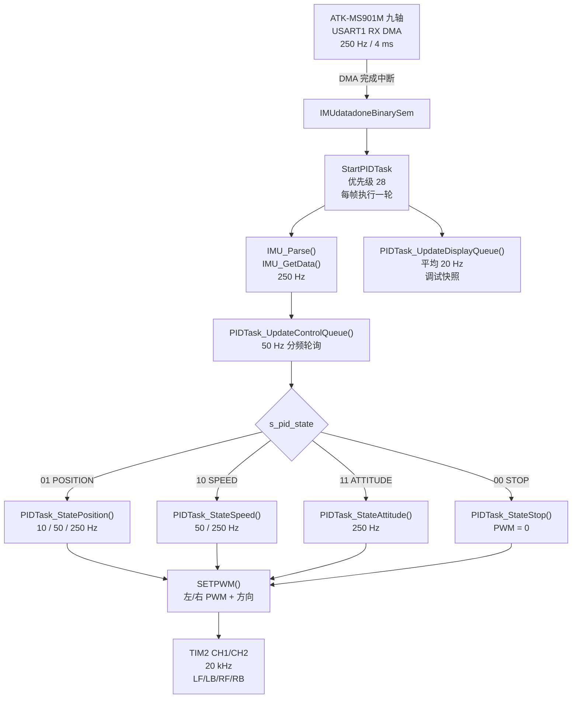
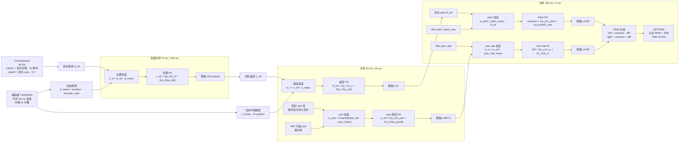
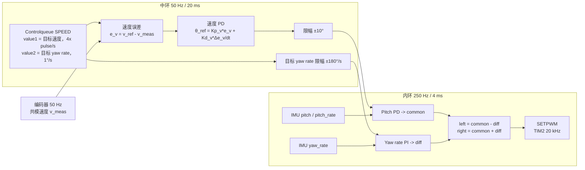
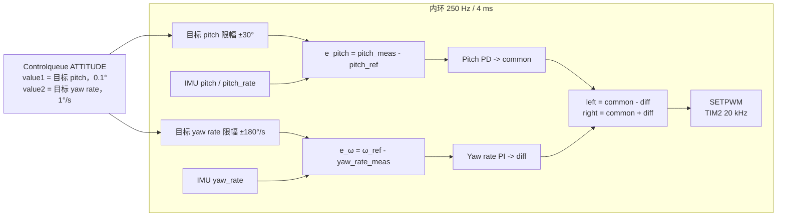
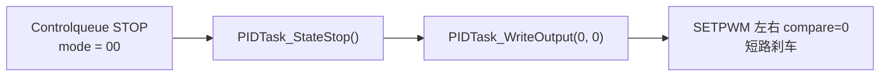

# PID 层级控制图（当前代码实现）

> 文件：`tasks/PID_CONTROL_DIAGRAM.md`  
> 对应实现：`tasks/pid_task.c` / `tasks/pid_task.h`  
> 说明：图中限幅值来自当前宏定义；PID 参数目前仍为 `0.0f`，结构正确但尚未实车整定。

## 1. 总体任务与数据流



### 任务与频率

| 对象 | 频率 / 周期 | 触发方式 | 说明 |
|---|---:|---|---|
| ATK-MS901M IMU | 250 Hz / 4 ms | USART1 RX DMA 完成 | 28 B/周期，姿态 + 陀螺/加速度 |
| `StartPIDTask` | 约 250 Hz | `IMUdatadoneBinarySem` | 不调用 `osDelayUntil()`，跟随 IMU 帧 |
| `controlTask` | 50 Hz / 20 ms | `osDelayUntil()` | 赛题流程、路径状态机、Controlqueue 生产者 |
| `Controlqueue` 轮询 | 50 Hz / 20 ms | 每个 250 Hz tick 分频（每 5 tick） | 读模式与目标 |
| 位置外环 | 10 Hz / 100 ms | `tick % 25 == 0` | 位置 PD -> 目标速度 |
| 中环 | 50 Hz / 20 ms | `tick % 5 == 0` | 速度 PD、yaw 角度 PD |
| 内环 | 250 Hz / 4 ms | 每个 tick | Pitch PD + yaw rate PI -> PWM |
| OLED 显示 | 20 Hz / 50 ms | 独立 `displayTask` | 只读调试快照和运行计数，不参与控制 |

> `defaultTask` 优先级 44 只做初始化；PID 为 28，`controlTask` 为 13，`displayTask` 为 8。  
> PID 的 250 Hz 节拍完全由 IMU DMA 信号量驱动；没有 IMU 帧时 PID 不运行。

> 每层 `dt` 优先使用 DWT CYCCNT 实测值；DWT 不可用或间隔异常时回退到标称
> `4 ms / 20 ms / 100 ms`，并按 `20 ms / 100 ms / 500 ms` 上限截断，防止 D/I 项被异常放大。

## 2. 位置模式（POSITION）详细层级



### 位置模式要点

- 编码器只使用**共模量**：左右平均位置/速度；没有编码器差模转向。
- 每次收到 POSITION 命令都会重新锁存 `encoder_start`（以当前共模位置为新的 0 点）；
- 收到 POSITION 命令的当拍会**强制位置外环立即执行一次**，即使当前 tick 不是
  10 Hz 时隙；中环仍按 50 Hz 调度，内环每个 4 ms tick 执行；
- POSITION 是锁存状态：队列为空不会自动退出，外环继续按 10 Hz 运行，直到新的
  STOP/SPEED/ATTITUDE/POSITION 命令；
- yaw 零点只在**第一次从非位置模式进入位置模式**时锁存；同一位置模式内新命令直接覆盖目标 yaw 角，不累加。
- 外环 10 Hz 的输出是速度目标；中环 50 Hz 再把它变成目标倾角；内环 250 Hz 负责真正稳定车体。
- 中环在每个 tick 先读编码器，再计算速度和 yaw 角度环；内环每个 4 ms tick 都执行。
- `tick == 0` 时执行顺序是：**位置外环 -> 中环 -> 内环**（外环使用上一中环更新后的共模位置）。

## 3. 速度模式（SPEED）



速度模式特点：

- 没有位置外环；
- 有速度中环，但**没有 yaw 角度环**；
- `value2` 直接作为目标 yaw rate，再限幅到 ±180°/s；
- 不使用 yaw 零点；
- 编码器只提供共模速度。

## 4. 姿态模式（ATTITUDE）



姿态模式特点：

- 只跑 250 Hz 内环，便于单独整定 Pitch PD / yaw rate PI；
- 没有位置外环和速度中环；
- 目标 pitch、目标 yaw rate 直接来自 `Controlqueue`；
- 不使用 yaw 角度环，不使用编码器位置/速度。

## 5. 停止模式（STOP）



停止时仍按 50 Hz 轮询 `Controlqueue`，等待下一条命令。

## 6. 控制方程与符号约定

### 6.1 位置外环（10 Hz）

```text
e_d(k) = d_ref - d_meas(k)
d_meas = encoder_common_position - encoder_start
v_ref = Kp_d * e_d(k) + Kd_d * (e_d(k) - e_d(k-1)) / dt
v_ref = clamp(v_ref, ±50 pulse/s)
```

- `d_ref`、`d_meas` 单位：4 倍频编码器脉冲；
- `encoder_start` 在收到 POSITION 命令时锁存；
- 输出 `v_ref` 是速度中环的目标。

### 6.2 速度中环（50 Hz）

```text
e_v(k) = v_ref - v_meas(k)
θ_ref = Kp_v * e_v(k) + Kd_v * (e_v(k) - e_v(k-1)) / dt
θ_ref = clamp(θ_ref, ±10°)
```

- `v_meas` 是编码器共模速度，单位 4x pulse/s；
- 输出 `θ_ref` 是内环的目标 Pitch。

### 6.3 yaw 角度环（50 Hz，仅位置模式）

```text
e_yaw(k) = wrap180(yaw_ref - yaw_meas_relative)
ω_ref = Kp_a * e_yaw(k) + Kd_a * (e_yaw(k) - e_yaw(k-1)) / dt
ω_ref = clamp(ω_ref, ±180°/s)
```

- `yaw_meas_relative = wrap180(yaw_meas_absolute - yaw_zero)`；
- 位置模式第一次进入时锁存 `yaw_zero`；
- 输出 `ω_ref` 是 yaw rate 内环的目标。

### 6.4 Pitch 内环（250 Hz）

```text
e_pitch = pitch_meas - θ_ref
common = Kp_p * e_pitch + Kd_p * pitch_rate
common = clamp(common, ±4199)
```

注意当前代码的 Pitch 误差符号是：

```text
e_pitch = current_pitch - target_pitch
```

而不是 `target - current`。改符号前必须同步确认 IMU pitch 方向和电机正方向。

### 6.5 yaw rate 内环（250 Hz）

```text
e_ω = ω_ref - yaw_rate_meas
I(k) = clamp(I(k-1) + e_ω * dt, ±4199)
diff = Kp_ω * e_ω + Ki_ω * I(k)
diff = clamp(diff, ±4199)
```

### 6.6 PWM 合成与执行器

```text
pwm_left  = clamp(common - diff, ±4199)
pwm_right = clamp(common + diff, ±4199)
```

- 正 PWM = 正转，负 PWM = 反转；
- `SETPWM()` 把有符号 PWM 转成方向引脚 + TIM2 比较值；
- TIM2：20 kHz，ARR = 4199；
- `compare = 0` 时左右方向引脚都为 0，短路刹车。

## 7. Controlqueue 命令协议

`Controlqueue` 是 CubeMX 创建的 **6 字节 / 48 位消息队列**，深度 1；PID 按 **50 Hz** 轮询。

```text
bit 47..46 : mode
bit 31..16 : value1（int16）
bit 15..0  : value2（int16）
```

| mode（二进制） | 模式 | value1 | value2 |
|---|---|---|---|
| `00` | STOP | 忽略 | 忽略 |
| `01` | POSITION | 目标共模位移，4x 脉冲 | 目标 yaw 角，0.1°（相对首次进入零点） |
| `10` | SPEED | 目标共模速度，4x pulse/s | 目标 yaw rate，1°/s |
| `11` | ATTITUDE | 目标 Pitch，0.1° | 目标 yaw rate，1°/s |

补充：

- 位置模式：同一模式内新的 `value2` 直接覆盖目标 yaw 角，不累加；
- 速度模式：不使用 yaw 零点，不做 yaw 角度环；
- 姿态模式：只跑内环；
- 队列深度为 1，发送失败表示上一条命令还没被 PID 取走。

## 8. 各层输入/输出汇总

| 层级 | 频率 | 输入 | 输出 |
|---|---:|---|---|
| IMU 采集/解析 | 250 Hz | USART1 DMA 原始帧 | `pitch`、`pitch_rate`、`yaw_rate`、`yaw` |
| Controlqueue | 50 Hz | 6 字节命令 | 模式 + 目标值 |
| 位置外环 | 10 Hz | 目标/当前共模距离 | 目标共模速度 |
| 速度中环 | 50 Hz | 目标/当前共模速度 | 目标 Pitch |
| yaw 角度环 | 50 Hz（位置模式） | 目标/当前相对 yaw | 目标 yaw rate |
| Pitch 内环 | 250 Hz | 目标/当前 Pitch、pitch_rate | 共模 PWM |
| yaw rate 内环 | 250 Hz | 目标/当前 yaw rate | 差模 PWM |
| 电机执行 | 20 kHz PWM | 左右有符号 PWM | 左右轮方向 + 占空比 |
| OLED 调试 | 20 Hz | 68 字节 `LCD_Data_t` 快照 | 128×64 显示，不参与控制 |

## 9. 模式对比

| 模式 | 10 Hz 位置外环 | 50 Hz 速度中环 | 50 Hz yaw 角度环 | 250 Hz 内环 | 编码器读取 | yaw 零点 |
|---|---|---|---|---|---|---|
| STOP | — | — | — | 输出 0 | 否 | 否 |
| POSITION | 位置 PD | 速度 PD | 有 | Pitch PD + yaw rate PI | 是（共模位置/速度） | 首次进入锁存 |
| SPEED | — | 速度 PD | 无 | Pitch PD + yaw rate PI | 是（共模速度） | 不使用 |
| ATTITUDE | — | — | — | Pitch PD + yaw rate PI | 否 | 不使用 |

## 10. 当前实现注意事项

1. **PID 参数全部为 0.0f**：这张图描述的是结构和数据流，不代表当前能闭环行驶。
2. **编码器是 4 倍频计数**：所有以“脉冲/脉冲每秒”为单位的位置/速度目标、限幅和增益都要按 4x 尺度整定。
3. **Pitch 误差符号特殊**：`e_pitch = current - target`；调试时先确认 IMU 安装方向和电机正反转。
4. **左右 PWM 合成**：`left = common - diff`，`right = common + diff`；若 yaw 转向相反，优先检查 `IMU_YAW_RATE_SIGN` 和左右电机接线。
5. **输出量程**：当前 `PID_ATT_MAX_PWM = PID_ATT_MAX_DIFF_PWM = 4199`，对应 TIM2 ARR 4199；旧注释里的 1000 已过时。
6. **执行顺序**：位置模式在 `tick == 0` 时先执行外环，再执行中环，最后执行内环；中环更新编码器反馈，内环每 4 ms 都执行。
7. **显示任务独立**：`displayTask` 以 20 Hz 消费 `dataToLCDQueue`，只读取 PID/controlTask 的原子运行计数用于频率显示，不读取控制目标/反馈内部变量，也不参与控制。第 0 行 `P250 C50 E0` 中的 `P/C` 是用 8 个显示周期（约 400 ms）的 DWT 时间窗口计算的实测频率。

